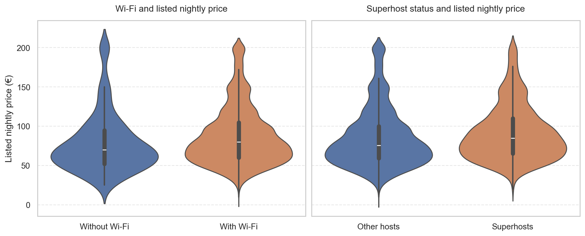

# Airbnb Madrid: Listing Features and Nightly Prices

**Which listing characteristics are associated with higher nightly prices?** This case study explores a property owner's request to review prices and potential improvements, using a comparable subset of Madrid Airbnb listings.

[Explore the notebook](airbnb-madrid-pricing-analysis.ipynb) · [Back to the portfolio](../README.md)

## What the comparisons show

Within the **9,027-listing study group**, amenities and Superhost status show price differences, while the reviewed guest-score and host-response measures have weak or near-zero correlations with price.

| Comparison | Median listed price | Group sizes |
|---|---|---|
| Wi-Fi | **€80 with Wi-Fi; €70 without** | 8,680 with; 347 without |
| Superhost status | **€85 for Superhosts; €75.50 for other hosts** | 2,177 Superhost; 6,850 other |

*Price distributions from the notebook's amenity and host comparisons, using the same study rows and grouping. The white marks indicate medians. Smoothed violin outlines can extend beyond the observed prices; all input prices are at most €200. [Figure provenance](../docs/FIGURE_SOURCES.md#airbnb-madrid).*

These comparisons help identify attributes to investigate when benchmarking a property. They do **not** establish that installing Wi-Fi or obtaining Superhost status will cause a particular price increase.

## Data and study scope

| Item | Scope |
|---|---|
| Unit of observation | One listing, joined using `id` |
| Input | Five Parquet tables: conditions, hosts, locations, properties, and reviews |
| Study group | Entire-home apartments, one to three bedrooms, with a kitchen |
| Price range | Listings priced at no more than €200 per night |
| Provenance | Data supplied with the original project; upstream source, collection date, and license need confirmation |

The notebook first explores market composition and price distributions. It then applies the study filters before comparing amenities, reviews, host characteristics, and cancellation policies.

## Why these analytical choices matter

- **Join the source tables:** combine property, host, and review information at listing level rather than analyzing disconnected files.
- **Narrow the comparison group:** focus on a defined property type and bedroom range. The €200 cap is an original scope decision, not a universal definition of a valid Airbnb price.
- **Use medians and distributions:** examine typical prices and group overlap, rather than relying on a single average.
- **Use the existing Spearman correlations:** examine review-score and response-rate relationships with price without introducing a new pricing model.

The analysis identifies amenities and Superhost status as attributes to investigate when benchmarking a property. The evidence supports investigating those differences; it does not quantify installation costs, booking gains, or returns on an improvement. Cancellation-policy comparisons also require caution because the strictest groups are small.

## Limits of the conclusions

This is a descriptive, one-characteristic-at-a-time analysis. It does not adjust jointly for other listing differences or estimate causal effects. Prices are listed prices, rather than realized booking revenue. Results apply to the selected apartments and price range, not the entire Madrid market. Review quality may matter for outcomes that this price analysis does not measure.

## Inspect or run

Start with the [notebook](airbnb-madrid-pricing-analysis.ipynb): market context, study filters, feature comparisons, and conclusions. The five input tables remain in `data/raw data/`.

From this project directory, install `pip install -r requirements.txt`, then launch `jupyter notebook airbnb-madrid-pricing-analysis.ipynb`. The complete notebook ran successfully in an isolated Python 3.14.3 environment on 21 October 2026. The [dependency list](requirements.txt) records the tested direct versions, including PyArrow for the Parquet inputs. [Setup and verification](../docs/REPRODUCIBILITY.md).

## Background

Adapted from the original Nuclio Digital School statistical-thinking project, preserving its questions, filters, and methods. [Original case in English](docs/airbnb_project_brief.md).
