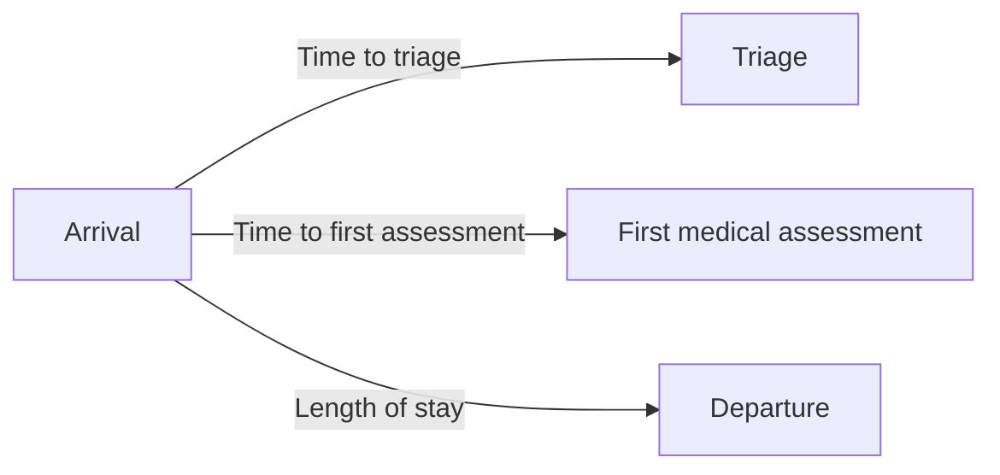

# Emergency Care: Activity, Triage, and Waiting Times

**Where and when does emergency-care workload accumulate, and how long do patients wait at key points in their care pathway?** This dashboard case explores visit activity across hospitals and services, together with triage, first-assessment, and length-of-stay measures.

[Open the Looker Studio dashboard](https://datastudio.google.com/s/qJ_o0SDeqv0) · [View the formula reference](outputs/dashboard-formulas-en.pdf) · [Back to the portfolio](../README.md)

## What the dashboard is designed to help investigate

- Changes in emergency-visit volume during the beginning of 2025.
- How visits are distributed across hospitals and treating services.
- The share of records with an admission proposal.
- Time from arrival to triage, first assessment, and departure.

These questions give the dashboard an operational purpose: help a reviewer locate workload and waiting-time patterns worth investigating. They do not establish that a particular service is saturated or that a delay has a known cause.

## Read the time indicators correctly

The three measures start at arrival but end at different events:

*This diagram explains the existing timestamp differences; it is not a screenshot or a measured patient-flow result.*

| Indicator | Definition | Interpretation |
|---|---|---|
| Visit count | Count of `id_urgencia` | Recorded visits within the selected scope |
| Mean time to triage | Arrival to triage, in minutes | Waiting time before classification |
| Mean time to first assessment | Arrival to first assessment, in minutes | Time until the first recorded medical assessment |
| Admission proposal share | Mean of a 0/1 indicator for `propuesta_ingreso = "Si"` | Share of records carrying the supplied proposal flag |

The existing `Tiempo` parameter switches the time measure used in the comparison by triage level. Its source values—`hasta triaje`, `hasta atención`, and `de estancia`—are retained to match the dashboard definitions. The parameter gives one comparison view three related uses without changing what each measure means.

## Data and implementation

The case concerns emergency-care activity in Asturias. The supplied [CSV](data/raw%20data/datos_urgencias.csv) contains visit identifiers, hospital and service fields, triage category, arrival and subsequent event timestamps, and admission-proposal information. The case focuses on early 2025; the supplied arrival timestamps also include late December 2024, so the selected reporting period must be explicit. The original upstream source and license are not documented.

Looker Studio calculated fields use the existing `DATETIME_DIFF` expressions to produce minute-based measures. The local formula reference checks the exact source value `Si`, rather than `Sí`, when constructing the admission flag. The [triage guide](docs/triage_levels.md) explains the category terminology.

## What is verified—and what remains open

The local field definitions and the `Si`/`No` spelling were checked against the supplied data. The shared dashboard has not been independently inspected here, so this README does not present numerical dashboard findings or a purported screenshot. Its current live formulas, filters, and visual appearance remain unverified.

The local [data validation](docs/data_validation.md) found literal `[NULL]` timestamps, inconsistent triage labels, and six event timestamps preceding arrival. Their live treatment remains unverified; no records or formulas were silently changed. Missing timestamps can change which records contribute to each time metric. The proposal flag does not independently verify an actual admission. Comparisons should therefore consider the selected hospitals, services, period, and available records before drawing operational conclusions.

## Explore the project

Use the dashboard link above for the interactive deliverable and the [English formula reference](outputs/dashboard-formulas-en.pdf) to inspect the calculations. The [original case in English](docs/emergency_care_dashboard_brief.md) records the initial questions. There is no Python notebook to run for this project.

## Background

Adapted from the original Nuclio Digital School visualization project. The documentation preserves the existing indicators, parameter, and source fields.
