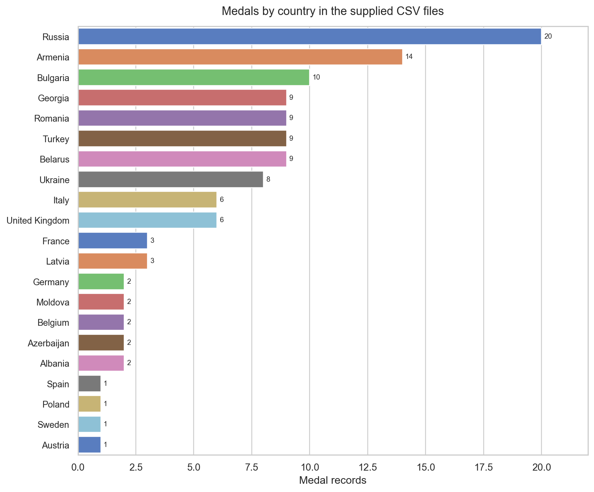

# European Weightlifting: From Medal Tables to Athlete Records

**How do competition results and medal outcomes vary across countries, genders, and weight categories?** This project prepares supplied championship tables, extends the sources through web scraping, and analyzes the resulting athlete records.

[Explore the notebook](european-weightlifting-analysis.ipynb) · [Back to the portfolio](../README.md)

## What the supplied files show

The initial preparation produces **120 medal-winning athlete records** from the two local CSV files. In those files, Russia has 20 medal records, Armenia 14, and Bulgaria 10.

*The original country-count comparison, re-rendered from the supplied-file preparation with English labels. The files retain their original 2019/2020 filenames; the second contains the postponed 2021 edition. This comparison uses the supplied historical results for 2019 and 2021. [Figure provenance](../docs/FIGURE_SOURCES.md#european-weightlifting).*

The expanded notebook retrieves the 2021–2024 pages and adds 2022–2024, counting the supplied 2021 edition once. The combined dataset has **300 medal records across five editions**. Armenia leads its medal table with 44; Bulgaria, Turkey, and Ukraine have 28 each.

## The preparation challenge

The source tables store gold, silver, and bronze medallists in separate columns. Athlete cells combine names, countries, and lift results, sometimes with footnotes or multi-word names.

The workflow reshapes those tables into one record per recorded medallist and extracts the fields needed for analysis:

| Source information | Analytical fields |
|---|---|
| Event text and source-year label | Event date and weight category |
| Medal column | Gold, silver, or bronze |
| Athlete text | First name, surname, and country |
| Lift expression | Snatch, clean and jerk, and total lifted weight |

Raw files and their original field names are preserved. Open-ended categories such as `+87` and `+109` remain distinct from `87` and `109` in the current transformation code.

## Questions examined

The same comparisons are retained for the supplied and expanded sources:

- How many medals of each type does each country have?
- Which countries have the most balanced medal counts across genders?
- Which country has the smallest gender difference in mean total lifted weight?

Distributions and category summaries provide additional context. The source population consists of medallists, not every competitor or the wider population.

## Data and sources

The local CSV files were supplied with the original project and labelled for [2019](https://es.wikipedia.org/wiki/Campeonato_Europeo_de_Halterofilia_de_2019) and [2020](https://es.wikipedia.org/wiki/Campeonato_Europeo_de_Halterofilia_de_2020). The scraper retrieves additional Wikipedia championship tables; all page links appear in the [English source brief](docs/weightlifting_project_brief.md).

The 2020 filename is an original source label. The notebook corrects the analytical year to 2021 in memory and avoids adding that edition twice. The raw CSVs are unchanged. [Source-year and version check](docs/source_validation.md).

## Interpretation and review limits

The work demonstrates a complete route from semi-structured medal tables to descriptive comparisons. It does not establish demand for a training centre or explain whether CrossFit increases public interest in weightlifting—the broader motivation of the original case.

The year and duplicate-edition corrections are implemented, and all notebook outputs have been regenerated. Of 60 supplied 2021 medal records, 57 match the current source page; three women’s 59 kg medals differ. The supplied historical version is retained consistently in both stages. Results describe those source versions, rather than the latest official medal allocation.

## Inspect or run

The [notebook](european-weightlifting-analysis.ipynb) retains both stages. [weightlifting_helpers.py](weightlifting_helpers.py) contains the original extraction and exploration helpers; inputs are in `data/raw data/`.

From this directory, install `pip install -r requirements.txt`, then launch `jupyter notebook european-weightlifting-analysis.ipynb`. The complete notebook, including live scraping, ran successfully in an isolated Python 3.14.3 environment on 21 October 2026. The [dependency list](requirements.txt) records the tested direct versions, including lxml for HTML tables. Scraping depends on external page availability and layout. [Setup and verification](../docs/REPRODUCIBILITY.md).

## Background

Adapted from the original Nuclio Digital School data-analysis project.
