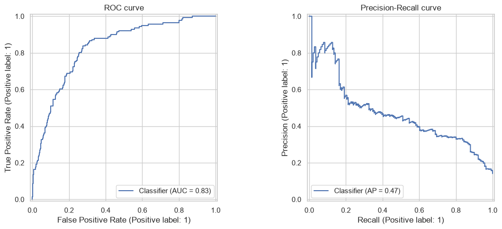

# Telecom Churn: Prioritizing 500 Customer Contacts

**Which customers should a telecom company prioritize when it can contact only 500 people?** This project combines a logistic-regression churn score with usage charges to build a value-weighted contact list, then compares that list with random selection.

[Explore the notebook](telecom-churn-priorization.ipynb) · [Back to the portfolio](../README.md)

## What the analysis found

The held-out sample contains **1,000 customers, including 141 who churned**. Selecting the top 500 by the existing ranking gives:

| Selection result | Model-ranked group | Expected random selection |
|---|---:|---:|
| Actual churners included | **124 of 141** | 70.5 |
| Usage charges associated with actual churners | **$8,392 of $9,207** | $4,604 |
| At-risk charge capture relative to random | **1.82x** | 1.00x |

The ranking puts approximately **91% of the observed at-risk charges** into a group containing half the test customers. This is a retrospective selection result: it does not show that outreach retained those customers or saved that revenue.



*Existing notebook output: test ROC-AUC is 0.829 and average precision is 0.469, against a churn-rate baseline of 0.141. These curves assess ranking across cutoffs; they do not verify probability calibration. [Figure provenance](../docs/FIGURE_SOURCES.md#telecom-churn).*

## Data and scope

| Item | Scope |
|---|---|
| Unit of observation | One customer |
| Input | 5,000 customers, 19 input fields, and the target `Churn` |
| Customer information | Plans, usage, charges, and service calls |
| Evaluation | Stratified 80/20 train/test split; 500 contacts from the 1,000-person test set |
| Data provenance | Supplied local CSV; upstream source and license remain undocumented |

The exploration found no missing values or repeated phone identifiers. Churn is associated with international-plan status, not having a voice-mail plan, more service calls, and higher daytime charges. The observed voice-mail churn rates are 16.45% without a plan and 7.71% with one.

## Key analytical choices

- **Reduce redundant inputs:** remove identifiers and `state`; retain charge variables instead of their nearly perfectly correlated minutes counterparts.
- **Build one interpretable model:** encode plan categories and scale numeric inputs in a pipeline with class-weighted logistic regression. Tune `C` using average precision and stratified cross-validation.
- **Evaluate ranking and classification separately:** examine ROC-AUC and average precision alongside precision/recall at the default cutoff. Five-fold evaluation on the training data reports ROC-AUC of 0.829 ± 0.022.
- **Include value in prioritization:** rank by `churn_probability × customer_value`, with summed usage charges as the value proxy. Since calibration is unverified, treat this product as a ranking score.

## What this supports—and its limits

The notebook defines a concrete contact-ranking rule and compares it retrospectively with random selection. The complete notebook was executed successfully in an isolated Python 3.14.3 environment on 21 October 2026.

Charges are a proxy for value; margin, lifetime value, contact costs, and intervention outcomes are absent. Class weighting may affect calibration. Internal tuning folds share fitted scaling; the held-out test remains separate, and the effect on tuning has not been quantified. The value comparison uses one split and one contact budget. Because half the sample is selected, the maximum possible value-capture lift at this budget is 2.0x. Calibration checks, other budgets, and measured outreach outcomes are follow-up work, not completed results.

## Inspect or run

The [notebook](telecom-churn-priorization.ipynb) contains the charts, decisions, and calculations. [churn_helpers.py](churn_helpers.py) supplies exploration helpers; the input is [churn_all.csv](data/raw%20data/churn_all.csv).

From this project directory, in a Python environment:

```bash
pip install -r requirements.txt
jupyter notebook telecom-churn-priorization.ipynb
```

The [dependency list](requirements.txt) records the direct versions used for that run. [Setup and verification](../docs/REPRODUCIBILITY.md). Tools used include pandas, NumPy, scikit-learn, matplotlib, seaborn, and missingno.

## Background

Personal portfolio project developed from the initial telecom churn analysis.
